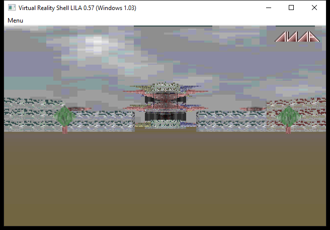
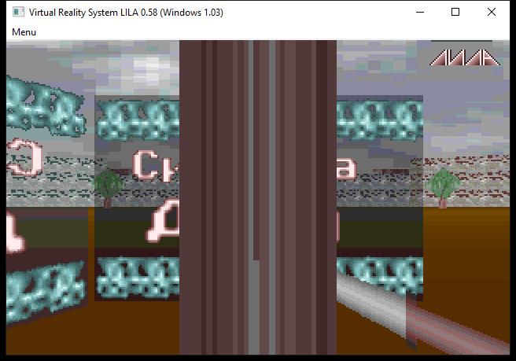
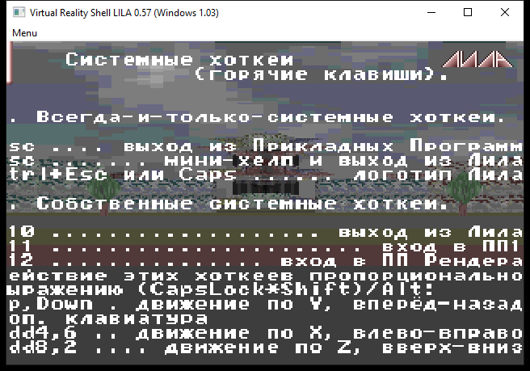

# VRS Lila (СВР ЛИЛА) — VR-система для DOS (1995–1996) и её порт на Windows

**«Лила»** — система виртуальной реальности в духе начала 90-х:
трёхмерный пейзаж со стенами, стеклянными воротами, деревьями и башней,
полностью на фиксированной арифметике 16.16, свой софтверный рендер и
синтезатор звуков «спикером».
Написана автором проекта — **Вадимом Мадгазиным** — на Turbo C для DOS
в 1995–1996 годах (VGA 13h, 320×200, 256 цветов).

В 2026 году портирована в ZCode на современную Windows:
**чистый C, только системные WinAPI/WinMM, без внешних DLL и рантаймов**.
Оригинальные исходники сохранены без изменений в `LILA/`, портированные копии
живут в `port/` (все правки помечены `//PORT:`).

| Программа | Оригинал | Что это |
|---|---|---|
| `lila57.exe` | `LILA/57/` | «Virtual Reality **Shell 0.57**» — демонстрация многозадачности: курсор, карандаш, редактор прикладных программ |
| `lila58.exe` | `LILA/58/` | «Virtual Reality **System 0.58**» — стрелялка: нож, бросок в цель, разрыв панелей на осколки, гравитация |
| `lila_install.exe` | `LILA/49i/` | консольный генератор файлов данных (порт первой работоспособной версии VRS 49i) |

| 0.57 — мир и хелп-книжка | 0.58 — стрелялка |
|---|---|
|  |  |
|  | |

## Быстрый старт

Готовые сборки лежат в `exe/` — скопируйте папку куда угодно и запускайте
exe **из папки с данными**:

- `exe/v57_win_1.03/lila57.exe`
- `exe/v58_win_1.03/lila58.exe`
- `exe/v49i_win_1.00/` — только генератор данных

Требования: Windows 7/8/10/11 (32-битный exe, работает на 64-битной
Windows), никаких установок.

Управление (кратко; полный список — F1 в игре и `LILA/57/HELP.DOC`):

| Клавиши | Действие |
|---|---|
| стрелки / `8246` (NumPad) | движение и повороты; с **Ctrl** — скорости |
| **F1** | хелп-книжка появляется в 180 см перед вами (повторно — листание мышью) |
| **Tab** | проницаемость стен (клиппинг вкл/выкл) |
| **S** | звук вкл/выкл (по умолчанию включён, громкость 20% в Menu → Settings) |
| **F2/F3** | предыдущая/следующая текстура стен (.pp) |
| **P** | панель координат, **1–9** — варианты цвета/негатива стен |
| **F10** | выход |
| 57: **Ins/Del**, **Enter**, **F11** | видимость панелей ПП1, выбор панели, вход в ПП1 |
| 58: **Space**, **0** | бросок ножа, космос↔земля |

Окно 640×400 с меню **Menu → About / Help / Settings**: Help показывает
текст `help.txt` (можно редактировать), Settings — слайдеры громкости
(0..100%, по умолчанию 20%) и скорости рендера (10..90 FPS) с цифрой
реального FPS.

## Сборка из исходников

Нужен MinGW-w64 **i686** (32-битный таргет ради совместимости с Win7/8;
проверено на GCC 15.2.0, портативная установка без прав администратора —
см. `port/README.md`). Сборка всего одной командой:

```bat
port\build_all.bat
```

Файлы данных генерирует `port/install/lila_install.exe --all` (запускать
из папки данных): `keyboard.lii` и `sinus.lii` — бит-в-бит как в
оригинале 49i, шрифт CP866 и процедурные картинки дали (`PP/far0.pp`,
`PP/far1.pp`) — синтез. `syspal.lii` игра создаёт сама при первом запуске.

Подробности сборки, форматы данных, архитектура и отличия от оригинала —
в [`port/README.md`](port/README.md).

## История порта

Как DOS-программа 1995 года попала на Windows 2026-го: все встреченные
проблемы и баги — 16-битный `int`, прерывания и PIT, спикер, битые
координатные системы — описаны в [`HISTORY.md`](HISTORY.md).

## Структура репозитория

```
LILA\               оригинальные исходники DOS (Turbo C, CP866) — только чтение
port\               порт на Windows (чистый C + WinAPI)
  common\           бэкенд: окно, клавиатура/мышь, звук waveOut, fix-математика
  install\          генератор данных
  vrs57\, vrs58\    модули игр (main/ядро/рендер/система/прикладная ПП1)
  vrsNN\data\       готовые данные + exe
exe\                готовые релизы (exe + данные)
docs\               скриншоты
```

---
© Вадим Мадгазин, 1995–1996 (оригинал), ZCode 2026 (порт на Windows).
